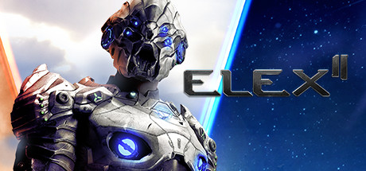

**ELEX II is Piranha Bytes' ambitious sequel where Jax returns as commander against the new Skyand alien threat, flying across Magalan using a jet pack. Features four joinable factions, open-world exploration, and the signature Piranha Bytes challenge spike design.**

---

## 📖 About

ELEX II is Piranha Bytes' ambitious sequel where Jax returns as commander against the new Skyand alien threat, flying across Magalan using a jet pack. Features four joinable factions, open-world exploration, and the signature Piranha Bytes challenge spike design.

## ⚠️ Problems Without Trainer

| Problem | Status |
|---------|--------|
| **Piranha Bytes Jank** — Production values are rough but the world and systems are deeply rewarding | ✅ Solved |
| **Combat Learning Curve** — Early combat punishes aggressive play until dodge timing is mastered | ✅ Solved |
| **Faction Loyalty** — Switching factions requires returning all faction equipment | ✅ Solved |
| **Exploration Reward** — Not exploring thoroughly means missing significant equipment upgrades | ✅ Solved |

## ✅ Solution

The **ELEX II Trainer** solves all these issues by giving you complete control over the game.

## 🎯 Full Feature List

- Unlimited Resources
- God Mode / Invincibility
- Instant Skill Cooldown
- One-Hit Kill
- Freeze Game Timer
- Unlock All Items & Achievements
- Custom Speed Multiplier
- Save State Anywhere

## 🚀 Quick Start

1. **Disable Windows Defender** temporarily (trainer may trigger false positive)
2. Download the trainer from the button above
3. Launch ELEX II
4. Run the trainer as Administrator
5. Activate desired cheats with hotkeys

## 💎 Free vs Paid

| Feature | Free | Pro |
|---------|------|-----|
| Basic God Mode | ✅ | ✅ |
| Unlimited Resources | ✅ | ✅ |
| All Advanced Cheats | ❌ | ✅ |
| Auto-Updates | ❌ | ✅ |
| Priority Support | ❌ | ✅ |

## 💻 Requirements

- Windows 10/11 (64-bit)
- ELEX II (any version)
- .NET Framework 4.8+
- DirectX 11+

## 🍎 macOS

macOS users can use our alternative tool:

## ⚖️ Legal

This trainer is for educational and single-player use only. Use responsibly.

---

